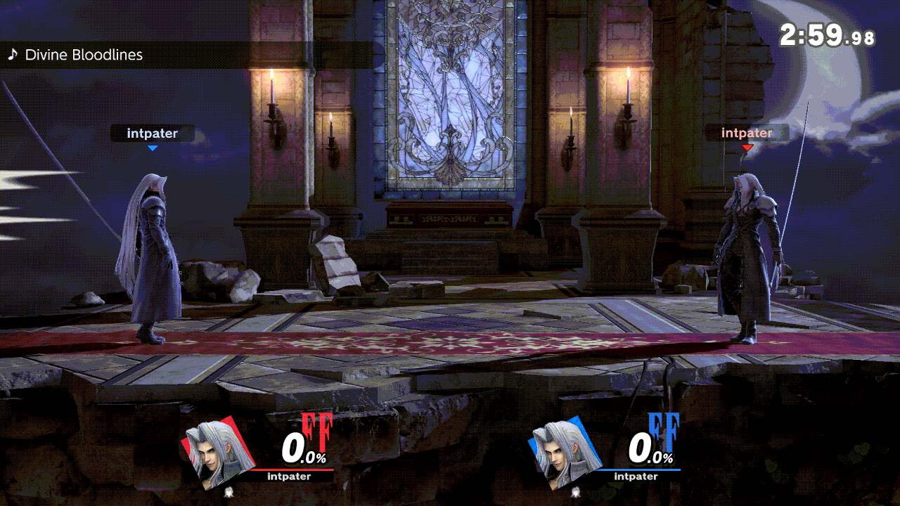

# ssbu-cpu-pilot

> **Disclaimer:** this project was developed with the assistance of AI
> (Claude, Codex and other coding agents) under the operator's direction and
> review. Nothing is claimed beyond the dated tests cited below.

A Skyline plugin for Super Smash Bros. Ultimate 13.0.5. It hands P1 to the
game's own CPU and back, at any time before, during or after a match, so a
match can go on when you have to step away, or a mod can be tested against a
CPU on both sides. With Online Deluxe installed, it adds a "CPU Pilot" group
to Deluxe's Plugins page:

| Row | Choices | What it does |
| --- | --- | --- |
| P1 | Player / CPU | The CPU drives P1's pad, and P1's HUD tag reads "CPU Lv<n>". While it does, **L+R+X** on P1's controller cycles the CPU level 1–9. |
| Auto rematch | Off / On | Online, answers Yes on the ordinary Quickplay/Elite "Rematch?" pop-up. |
| Auto save replay | Off / On | Offline, saves the replay from the results screen through the game's own Save Replay dialog. |

The CPU's decisions come from P1's own native AI object, run on a private
copy of the AI random stream and written to P1's mapped input; the shared
random streams and P1's controller fields are restored after every decision.
P1 always starts as the player after a boot. Offline battles need a native
CPU present (Training, local Smash). Online, in a 1v1 Quickplay match, the
CPU drives the local player: the plugin starts the AI service's stage
analysis on this console under a private copy of the AI random stream, so
the opponent's console only ever receives ordinary inputs. Two asymmetric
Eden matches (plugin console against a vanilla one) passed the desync
detector's end check; switching mid-match, a replay A/B and broader
simulation-state checks are still to be tested ([docs/ONLINE.md](docs/ONLINE.md),
[docs/EDEN-RESULTS.md](docs/EDEN-RESULTS.md)).

Results automation presses buttons for P1's port only, each step gated on
the game's own state, and stops for that results screen when a step does not
happen in time ([docs/RESULTS.md](docs/RESULTS.md)).

*Status (2026-10-31): experimental, not yet released. Tested in Eden:
P1 as CPU in Training (on and off mid-fight, L+R+X, the HUD tag), the
Deluxe rows, the card's other 16 plugins alongside, auto save replay in a
local match, and the CPU driving the local player online, switched on and
off mid-match, against a vanilla console with the desync detector on both
(`desync_seen=0` at the same frame). Not yet tested: auto rematch. Evidence:
[docs/EDEN-RESULTS.md](docs/EDEN-RESULTS.md). Not tested on a Switch.*



*Native CPU approach and attacks during asymmetric Quickplay; the match
continues beyond the clip. Eden `o03`, 2026-10-31, diag NRO `e63b3cc3c648650d`; every second frame.*

## Library

`core/` is the `ssbu-cpu-pilot-core` crate: settings and their INI form, the
L+R+X level cycle, the level-to-rank ladder, the AI-to-pad encoding, the
per-frame pilot session, online admission, the results policy and the HUD
label, plus (feature `native`) the raw AI calls. It has no Skyline
dependency, so another plugin, such as the Training Modpack, can use it with
its own hooks and Skyline version ([docs/LIBRARY.md](docs/LIBRARY.md)).

## Install

Copy `libssbu_cpu_pilot.nro` to
`sd:/atmosphere/contents/01006A800016E000/romfs/skyline/plugins/`. Its data
folder is `sd:/ultimate/ssbu-cpu-pilot/` (`events.log`, `config.ini`).
Online Deluxe 0.5.3 or later shows the rows; without it the plugin has no
menu.

## Build

```text
cargo test --workspace
cargo clippy --workspace --all-targets -- -D warnings
cargo build --workspace --no-default-features
pwsh -File tools/build.ps1 -Kind release   # cargo skyline build --release -> dist/release
pwsh -File tools/build.ps1 -Kind diag      # --features diag, the Eden build -> dist/diag
```

Toolchain 1.98.1 (`rust-toolchain.toml`), `skyline = "=0.6.0"`.

## License

MIT, see [LICENSE](LICENSE).
