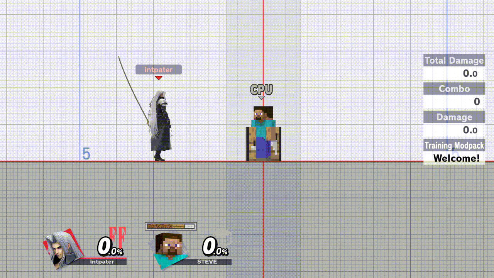
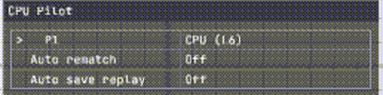
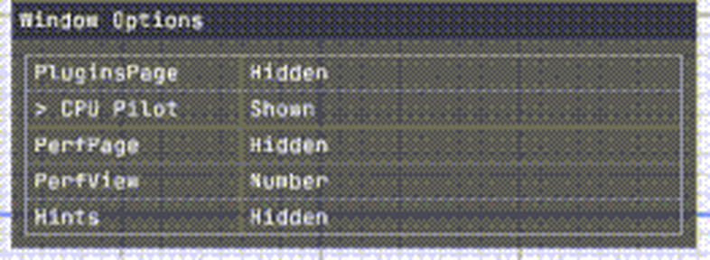

# ssbu-cpu-pilot

A Skyline plugin for Super Smash Bros. Ultimate 13.0.5 that hands P1 to the
game's own CPU and back, at any time: step away mid-match, or let a CPU play
your side while you test a mod. It can also answer the online "Rematch?"
pop-up and save replays for you, offline and online.



*Eden, 2026-11-01, Training (run `m05`): L+R+Down to the CPU Pilot page,
ZR+Right sets P1 to `CPU (L5)`, L+R+X twice steps it to `CPU (L7)` (HUD tag
`CPU Lv7`), Window Options, then the window closes and the CPU fights with the
controller idle. Online Deluxe 0.10.1, ssbu-cpu-pilot 0.2.1 (release
`e3033426`, commit `502b6e2`), 10 fps.*

**Status (2026-11-13):** 0.2.4 is the current version. It has been on a Switch
card since 2026-11-12 and passed its Eden check that day; no Switch play of it
is on record yet. The last Switch report is of 0.2.2, driving P1 in an Elite
Smash match (2026-11-02). There is no release after v0.2.2.

## Use

Press **L+R+Down** until Online Deluxe shows the **CPU Pilot** page, then
**ZR+Right/Left** on a row:



| Row | |
| --- | --- |
| P1 | `Player`, or `CPU (L1)` … `CPU (L9)`. ZR+Right/Left switches between you and the CPU in one press and keeps the level. |
| Auto rematch | Answers Yes to the online "Rematch?" pop-up. |
| Auto save replay | Saves the replay at the results screen, offline and online (then answers "Rematch?" if Auto rematch is on). |

- **Where the CPU plays P1:** Training, offline matches, Quickplay and Elite
  Smash battles, and (since 0.2.3) the practice in Quickplay's waiting room.
  When a match is found there, the CPU keeps P1 in the match. Not in
  local-wireless battles. Menus stay yours. P1 wears the HUD tag `CPU Lv<n>`
  (the waiting-room practice shows no tag).
- **Level:** **L+R+X** steps it 1 → 9 → 1 while the CPU plays P1. It starts at
  3 and is saved. Press it on the P1 row (Online Deluxe 0.10.1 or later) or on
  P1's controller during a match. With Deluxe 0.10.5 or later (0.2.4), L+R+X
  belongs to Deluxe's window while it shows a page with rows: on the P1 row it
  steps the level once, on other rows it leaves the level alone. Deluxe 0.10.5
  is not a published release yet (2026-11-13).
- After a reboot P1 is you again.
- The Auto rows don't depend on the P1 row. Auto save replay was tested with
  P1 as you and as the CPU, Auto rematch with the CPU on P1.

If the page is not in the cycle, show it on Deluxe's last page, Window
Options (Deluxe 0.10.0 or later):



## Install

Build `libssbu_cpu_pilot.nro` (below) and copy it to
`sd:/atmosphere/contents/01006A800016E000/romfs/skyline/plugins/` (data:
`sd:/ultimate/ssbu-cpu-pilot/`). The page needs
[Online Deluxe](https://git.syntaxbyexample.com/intpa/ssbu-online-deluxe-rewrite)
0.5.3 or later. If your Training Modpack build has its own P1-as-CPU option,
leave it off while this plugin drives P1. (The Training Modpack fork built on
this plugin's library stands down by itself when this plugin is installed.)

## More

- Online play and what was checked against a vanilla console: [docs/ONLINE.md](docs/ONLINE.md)
- Rematch and replay automation: [docs/RESULTS.md](docs/RESULTS.md)
- The `ssbu-cpu-pilot-core` library, for plugins such as the Training Modpack: [docs/LIBRARY.md](docs/LIBRARY.md)
- [smash-gamepad-overlay](https://git.syntaxbyexample.com/intpa/smash-gamepad-overlay) 0.3.0 shows the CPU's inputs on P1's own layout
- Test evidence (Eden, and Switch sessions on 2026-11-02): [docs/EDEN-RESULTS.md](docs/EDEN-RESULTS.md)
- Changes by version: [CHANGELOG.md](CHANGELOG.md)

## Build

```text
cargo test --workspace
cargo clippy --workspace --all-targets -- -D warnings
cargo build --workspace --no-default-features
pwsh -File tools/build.ps1 -Kind release   # cargo skyline build --release -> dist/release
pwsh -File tools/build.ps1 -Kind diag      # Eden build -> dist/diag
```

License: MIT, see [LICENSE](LICENSE).

> **Disclaimer:** this project was developed with the assistance of AI
> (Claude, Codex and other coding agents) under the operator's direction and
> review. Nothing is claimed beyond the dated tests cited above.
